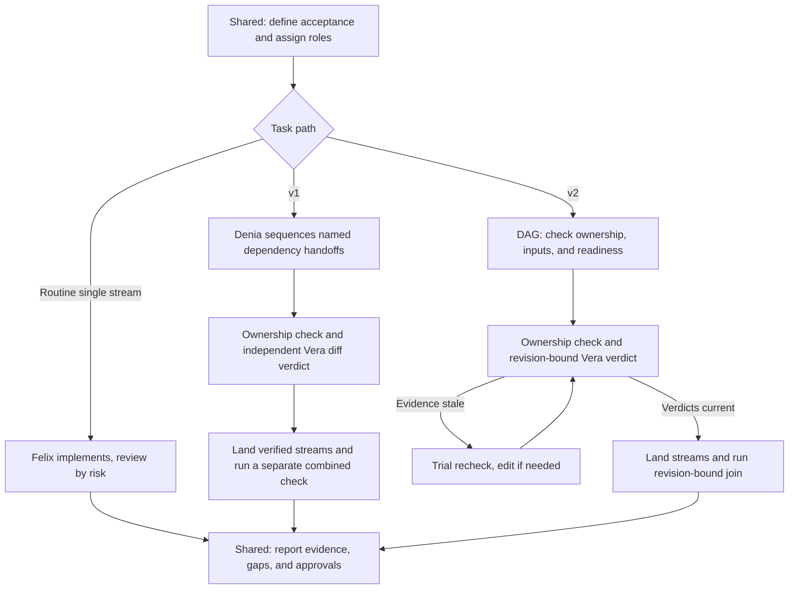

# Quintet

Quintet coordinates coding tasks through native subagents in Pi, Claude Code,
Antigravity CLI, and Codex. One installer offers two workflows. Both use the same
coordinator contract, worker profiles, and skills.

## Install

```sh
git clone https://github.com/LazyGreed/quintet.git
cd quintet
```

For Pi, the installer requires Pi 1.1.0 or later and Python 3.
`npm:@tintinweb/pi-subagents@0.26.3` declares Pi peers at 1.1.0 or later.
`npm:pi-web-access@0.48.0` requires Node.js 22.19.0 or later. Quintet tested
these pins with Pi 1.6.1 and Node.js 26.13.1. The installer
checks the exact registrations and installed manifests. It registers missing
pins globally, including for project installs, and reports conflicts before
changing settings. Resolve reported legacy, filtered, duplicate, or mismatched
registrations in Pi before retrying. Quintet creates `subagents.json` in
`${PI_CODING_AGENT_DIR:-$HOME/.pi/agent}` if absent.

Run `./install.sh` in a terminal. Use the arrow keys and Enter or Space to
select your harness, scope, and workflow. Review the choices before installing.
`v2` is selected by default.

For scripts, pass `--workflow v1` or `--workflow v2`. Omitting the flag also
selects `v2`.

```sh
./install.sh --harness pi --scope global --workflow v1
./install.sh --harness claude --scope global --workflow v2
./install.sh --harness antigravity --scope project --target /path/to/project
./install.sh --harness codex --scope global
```

Use the current installer with the same harness and scope to switch workflows.
The installer replaces the managed instructions and preserves the text outside
that block. Restart the harness session to load the updated rules.

| Option | Purpose |
| --- | --- |
| `--harness pi,claude,antigravity,codex` | Install any comma-separated subset |
| `--scope global` | Apply across projects |
| `--scope project --target PATH` | Apply to one project, defaulting to `.` |
| `--with-web` / `--no-web` | Enable (default) or omit web tool grants |
| `--dry-run` | Preview without writing files |
| `--tui` / `--no-tui` | Force or skip the terminal installer |

Project rules take precedence over global workflow rules for the active
harness. The installer backs up files it replaces and preserves model and
provider settings. A failed Pi install restores the package registration file.
Package-manager cache entries can remain. `--no-web` omits web tool grants from
worker profiles and retains the same Pi package prerequisites.

### Antigravity

Both workflows install the global `quintet` plugin at
`~/.gemini/config/plugins/quintet` or use `PROJECT/.agents` for project installs.
The coordinator loads through `rules/AGENTS.md`. Coordinator rule backups live
outside rule discovery, in `~/.gemini/config/quintet-rule-backups` for global
installs or `PROJECT/.quintet-rule-backups` for project installs. If the
installer reports `KEEP RULE`, inspect the named path and move that backup out
of rule discovery before retrying. Use `--dry-run` to see the planned moves.

### Codex

Project installs write `PROJECT/AGENTS.md` (the same file as Pi),
`PROJECT/.codex/agents/*.toml`, and skills under `PROJECT/.agents/skills`.
Global installs write `AGENTS.md`, `agents/*.toml`, and `skills/` under
`${CODEX_HOME:-~/.codex}`. Codex uses its existing `config.toml`, including
its web settings and project trust. Trust the project in Codex to load its
project-local agents. `--no-web` controls
web tool grants Quintet adds for Pi, Claude Code, and Antigravity CLI.

## Agents and personality

| Agent | Responsibility | Scope |
| --- | --- | --- |
| **Coordinator** | Delegates, sequences work, and verifies | Main session |
| **Nora** | Researches contracts and root causes | Read-only |
| **Felix** | Implements changes and runs focused checks | Owned paths |
| **Vera** | Independently reviews diffs and evidence | Read-only |
| **Iris** | Checks acceptance and smoke behavior | Read-only |

For the native tool boundaries and how the coordinator supplies executable
check evidence, see [Read-only verification](docs/read-only-verification.md).

Denia is the default coordinator. Edit [PERSONALITY.md](PERSONALITY.md) in the Quintet checkout
for global installs. For project installs, edit `PROJECT/PERSONALITY.md`. The
installer creates it if missing and keeps your edits on reinstall. The first
line must be `Name: Your Name`.
Rerun the installer to apply the name and style to the coordinator, including
its global Antigravity display name. The four workers keep their roles.

The installer refuses Antigravity rules over 24,000 bytes and applies the
32,768-byte default Codex budget to `AGENTS.md`. The check includes existing
user instructions and any Antigravity legacy rules being carried over. Long
custom personalities can exceed these limits.

## Compare the workflows



Both workflows use isolated worktrees and exclusive write ownership for
parallel writers, an independent Vera verdict per stream, and a separate
combined check. [v1](workflows/v1.md) sequences handoffs through the
coordinator and reviews the actual diffs. [v2](workflows/v2.md) tracks hard
and read-only dependencies, refreshes stale evidence, and binds its join
check to the landed commits. Final merge, push, and deployment require
explicit approval in both workflows.

## Specialized skills

- [Alien Science Ideation](skills/alien-science-ideation/SKILL.md) is installed
  by default. The coordinator loads it only when the user explicitly requests
  alien ideation, cognitively unavailable research directions, or the skill.
- The [weight-space network audit](skills/weight-space-network-audit/SKILL.md)
  supports protocol-based ReLU audits, read-only checkpoint inspection, and
  explicitly requested diagnosis or reversible edits on safe copies.

## Checks

```sh
bash tests/install-e2e.sh
python3 tests/tui-e2e.py
bash tests/workstream-e2e.sh
python3 tests/live-graph.py --self-test
```

These checks exercise the installers with Pi mocked, the terminal UI, the
Git ownership and read-only gates, and offline graph fixtures. The opt-in
live scripts use `tests/live-parallel-smoke.sh` with Antigravity CLI or Claude
Code, and `tests/live-graph.py --live` with Claude Code. The live Q0/Q1
comparison is pending. [Evaluation protocol](docs/workflow.md#v2-evaluation)

## Documentation

- [Workflow and evaluation](docs/workflow.md)
- [Peer messaging by harness](docs/peer-messaging.md)
- [Model and effort guide](docs/model-guide.md)
- [Shared coordinator contract](AGENTS.md) and [worker profiles](agents/)
- [Skills](skills/)
- [Research lineage and acknowledgements](docs/references.md)
