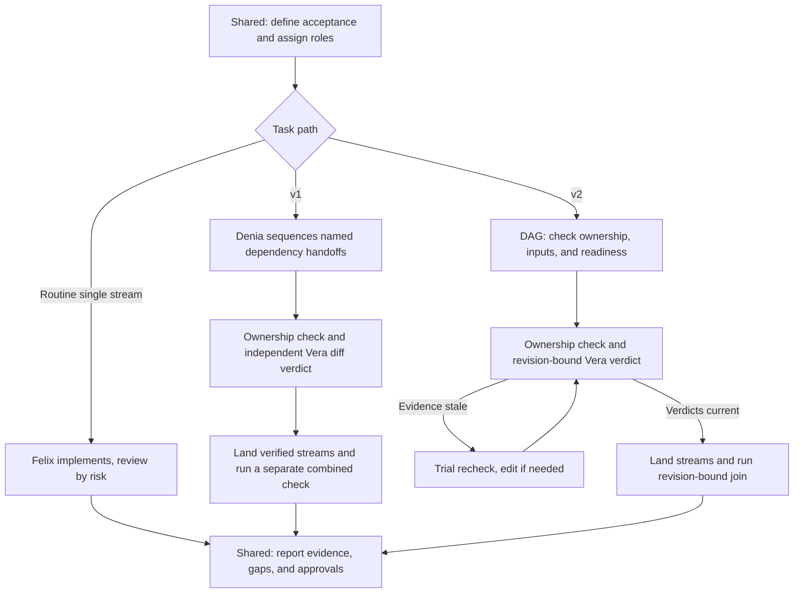

# Quintet

Quintet coordinates coding tasks through native subagents in Pi, Claude Code,
and Antigravity CLI. One installer offers two workflows. Both use the same
coordinator contract, worker profiles, and skills.

## Install

```sh
git clone https://github.com/LazyGreed/quintet.git
cd quintet
```

For Pi, install Pi 1.1.0 or later and register its subagent package first.

```sh
pi install npm:@tintinweb/pi-subagents
```

Run `./install.sh` in a terminal. Use the arrow keys and Enter or Space to
select your harness, scope, and workflow. Review the choices before installing.
`v2` is selected by default.

For scripts, pass `--workflow v1` or `--workflow v2`. Omitting the flag also
selects `v2`.

```sh
./install.sh --harness pi --scope global --workflow v1
./install.sh --harness claude --scope global --workflow v2
./install.sh --harness antigravity --scope project --target /path/to/project
```

Use the current installer with the same harness and scope to switch workflows.
Do not run an installer from an archived branch: it can recreate the legacy
Albert plugin. The current installer replaces the managed instructions and
preserves the text outside that block. Restart the harness session to load the
updated rules.

| Option | Purpose |
| --- | --- |
| `--harness pi,claude,antigravity` | Install any comma-separated subset |
| `--scope global` | Apply across projects |
| `--scope project --target PATH` | Apply to one project, defaulting to `.` |
| `--with-web` / `--no-web` | Enable (default) or skip web access |
| `--dry-run` | Preview without writing files |
| `--tui` / `--no-tui` | Force or skip the terminal installer |

Project rules take precedence over global workflow rules for the active
harness. The installer backs up files it replaces and preserves model and
provider settings. With web access enabled, the installer registers the Pi
web package when needed. `--no-web` leaves existing registrations in place.

> [!WARNING]
> Before updating an old checkout, save independent copies of any configuration
> you symlinked into it. The old bundled `settings.json`, `claude-settings.json`,
> `antigravity-settings.json`, and `pi-blackhole` configs were removed from the
> source tree. Point your harness at your saved copies before updating.

### Antigravity upgrades

Both workflows install the global `quintet` plugin at
`~/.gemini/config/plugins/quintet` or use `PROJECT/.agents` for project installs.
The coordinator loads through `rules/AGENTS.md`. A global install archives an
eligible legacy `plugins/albert` tree intact under
`~/.gemini/config/quintet-backups` after writing the new plugin. It carries user
rules outside the legacy managed block into the new rules. If the old tree
contains extra entries, the installer lists them and leaves the tree in place.
Preview with `--dry-run` or the terminal installer's review screen.

Antigravity coordinator rule backups live outside rule discovery: in
`~/.gemini/config/quintet-rule-backups` for global installs or
`PROJECT/.quintet-rule-backups` for project installs. Reinstalling also moves
old `AGENTS.md.albert-backup-<timestamp>-<pid>` files out of the active rules
folder, including backups with only user instructions. If the installer reports
`KEEP RULE`, inspect the named path and move the old backup out of rule discovery
before retrying. Use `--dry-run` to see the planned moves.

An earlier project install may still have `.agents/agents/albert.md`. If you
previously selected that coordinator, move the file somewhere outside agent
discovery to keep the old profile and use the new project rules.

## Agents and personality

| Agent | Responsibility | Scope |
| --- | --- | --- |
| **Coordinator** | Delegates, sequences work, and verifies | Main session |
| **Nora** | Researches contracts and root causes | Read-only |
| **Felix** | Implements changes and runs focused checks | Owned paths |
| **Vera** | Independently reviews diffs and evidence | Read-only |
| **Iris** | Runs acceptance and smoke checks | Read-only on source |

Denia is the default coordinator. Edit `PERSONALITY.md` in the Quintet checkout
for global installs. For project installs, edit `PROJECT/PERSONALITY.md`. The
installer creates it if missing and keeps your edits on reinstall. The first
line must be `Name: Your Name`.
Rerun the installer to apply the name and style to the coordinator, including
its global Antigravity display name. The four workers keep their roles.

Antigravity truncates rules above 24,000 bytes. The default personality fits
with either workflow. A long custom personality can exceed the limit.

## Compare the workflows



Both workflows use isolated worktrees and exclusive write ownership for
parallel writers, an independent Vera verdict per stream, and a separate
combined check. [v1](workflows/v1.md) sequences handoffs through the
coordinator and reviews the actual diffs. [v2](workflows/v2.md) tracks hard
and read-only dependencies, refreshes stale evidence, and binds its join
check to the landed commits. Final merge, push, and deployment require
explicit approval in both workflows.

## Specialized skills

- [Alien Science Ideation](skills/alien-science-ideation/SKILL.md) is installed
  by default. The coordinator loads it only when the user explicitly requests
  alien ideation, cognitively unavailable research directions, or the skill.
- The [weight-space network audit](skills/weight-space-network-audit/SKILL.md)
  supports protocol-based ReLU audits, read-only checkpoint inspection, and
  explicitly requested diagnosis or reversible edits on safe copies.

## Checks

```sh
bash tests/install-e2e.sh
python3 tests/tui-e2e.py
bash tests/workstream-e2e.sh
python3 tests/live-graph.py --self-test
```

These checks exercise the installers with Pi mocked, the terminal UI, the
Git ownership and read-only gates, and offline graph fixtures. The opt-in
live scripts use `tests/live-parallel-smoke.sh` with Antigravity CLI or Claude
Code, and `tests/live-graph.py --live` with Claude Code. The live Q0/Q1
comparison is pending. [Evaluation protocol](docs/workflow.md#v2-evaluation)

## Documentation

- [Workflow and evaluation](docs/workflow.md)
- [Peer messaging by harness](docs/peer-messaging.md)
- [Model and effort guide](docs/model-guide.md)
- [Shared coordinator contract](AGENTS.md) and [worker profiles](agents/)
- [Skills](skills/)
- [Research lineage and acknowledgements](docs/references.md)
