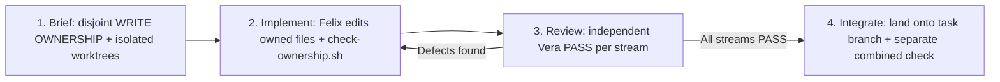

# Workflow

Quintet uses your harness's native subagents. The coordinator is **Denia** by default; only its name and personality are customizable, while Nora, Felix, Vera, and Iris retain fixed roles.

## Task flow

1. **Understand:** Define the outcome and one observable acceptance condition. Skip planning overhead for routine work.
2. **Investigate if needed:** Nora resolves a concrete missing fact or prerequisite.
3. **Implement:** Felix makes changes and runs focused checks. The coordinator does not edit application code or configuration.
4. **Verify:** Vera independently reviews consequential changes. Iris checks user-facing behavior when useful.
5. **Report:** Emit `DONE`, `PARTIAL`, or `BLOCKED` with exact observed checks. Mark unrun checks `NOT RUN`.

Workers never delegate to other workers. Denia makes in-scope technical decisions without asking for routine approval.

## Opt-in Alien Science Ideation

Do not load or apply `skills/alien-science-ideation/SKILL.md` unless the user explicitly asks for alien science, alien ideation, cognitively unavailable research directions, or this skill by name. Ordinary research, design, brainstorming, "be creative", or an unconventional-looking task is not a request. Workers apply it only when the brief states the user explicitly requested it.

No new worker, mode, or permission is added. Do not claim novelty or improvement without supporting evidence, and keep all ownership, review, and approval gates intact.

## Weight-space network audit

Under the [coordinator contract](../AGENTS.md#task-specific-weight-space-network-audit), the [weight-space network audit skill](../skills/weight-space-network-audit/SKILL.md) uses a three-mode activation contract:

| Mode | Trigger | Scope |
| --- | --- | --- |
| **Specialized ReLU (`references/relu-audit.md`)** | Default for small feed-forward ReLU decision networks | Audit or authorized repair with accessible weights and an explicit protocol |
| **Read-only audit (`AUDIT_ONLY`)** | User asks to inspect a checkpoint without edits | Architecture and weight audit only; a weight file alone never authorizes edits |
| **Universal improvement (`AUTO_IMPROVE`, `DIRECT_ONLY`, `RESEARCH`)** | Explicit request for model improvement or universal methods | Cross-architecture diagnosis and reversible edits on safe copies only; never unrequested LLM editing, full training, or original-checkpoint mutation |

Test behavior against the protocol before diagnosing weights, and verify candidate deviations on independently sampled requests. When edits are authorized, work on a copy, compare against the original and baseline, and check collateral damage and deployment precision. Use existing Nora/Felix/Vera/Iris roles and approval gates, report inconclusive or unrun checks explicitly, and never treat sampled agreement as clearance.

## Parallel work

Parallel implementation is optional. Add **instances**, not roles (`felix-api`, `felix-ui`). Aliases alone do not provide filesystem isolation.



Every parallel writer receives a structured brief:

```text
STREAM: api
INSTANCE/ROLE: felix-api / felix
GOAL: Return stable validation errors
WRITE OWNERSHIP: server/validation/**, tests/validation/**
DO NOT EDIT: server/routes/**, shared/config/**
CHECKOUT: verified isolated worktree/branch
ACCEPT: valid input succeeds; invalid input returns documented error fields
CHECKS: focused API tests and an error-path regression
DEPENDENCIES: ui consumes those error fields
VERIFIER: vera-api / vera
```

Only one writer owns each path, including generated files and lockfiles. If isolation or ownership cannot be verified, run writers sequentially. A worker discovering a new required path reports it to the coordinator instead of editing out of scope.

Before integration, **each** parallel stream needs a mechanical changed-path ownership check (`skills/verification/scripts/check-ownership.sh`) and its own independent Vera `PASS` on the actual diff and acceptance evidence. Read-only specialists can verify checkout integrity mechanically with `skills/verification/scripts/check-readonly.sh`. Integrate verified streams into a dedicated task branch and run a separate combined integration check; passing isolated streams does not prove integration works.

## Blockers and recovery

| Blocker type | Owner & action |
| --- | --- |
| Missing evidence or contract | Nora investigates the narrow question |
| Implementation defect | Felix fixes it and reruns focused checks |
| Missing tool, access, or permission | Inspect and report the actual blocker |
| User-only decision or authority boundary | Ask the user |

Allow at most two automatic fix/re-review rounds. Never retry an unchanged failing approach or invent a passing test.

## Messaging

Use native peer messaging only when supported and enabled. Peers may share a contract, dependency, blocker, or review finding, but cannot grant ownership, change acceptance, or authorize actions. Otherwise, relay through the coordinator. See [peer messaging](peer-messaging.md).

## Pi specifics

- Requires Pi 1.1.0+ and `npm:@tintinweb/pi-subagents` (`Agent`, `steer_subagent`, `get_subagent_result`).
- Inspect workers via FleetView or `/agents`; worker profiles use `prompt_mode: append`.
- `defaultJoinMode: group` in `subagents.json` batches parallel completion notices, which delays early results; the installer leaves it untouched.

## Limits

Quintet has no daemon, supervisor, status database, or guaranteed background execution after parent exit. Recheck live state on resume and record long-running task decisions in an existing issue or PR. Final push, merge to main, deployment, destructive cleanup, or credential changes require explicit authorization. See [coordinator contract](../AGENTS.md).
