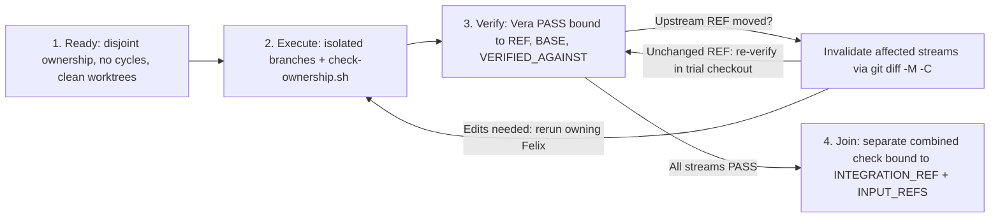

# Workflow

Quintet uses your harness's native subagents. The coordinator is **Denia** by default; only its name and personality are customizable, while Nora, Felix, Vera, and Iris retain fixed roles.

## Task flow

1. **Understand:** Define the outcome and one observable acceptance condition. Skip planning overhead for routine work.
2. **Investigate if needed:** Nora resolves a concrete missing fact or prerequisite.
3. **Implement:** Felix edits code, tests, configuration, and documentation and runs focused checks. The coordinator handles authorized Git operations.
4. **Verify:** Vera independently reviews consequential changes. Iris checks user-facing behavior when useful.
5. **Report:** Emit `DONE`, `PARTIAL`, or `BLOCKED` with exact observed checks. Mark unrun checks `NOT RUN`.

Workers never delegate to other workers. Denia makes in-scope technical decisions without asking for routine approval.

## Opt-in Alien Science Ideation

Do not load or apply `skills/alien-science-ideation/SKILL.md` unless the user explicitly asks for alien science, alien ideation, cognitively unavailable research directions, or this skill by name. Ordinary research, design, brainstorming, "be creative", or an unconventional-looking task is not a request. Workers apply it only when the brief states the user explicitly requested it.

No new worker, mode, or permission is added. Do not claim novelty or improvement without supporting evidence, and keep all ownership, review, and approval gates intact.

## Weight-space network audit

Under the [coordinator contract](../AGENTS.md#task-specific-weight-space-network-audit), the [weight-space network audit skill](../skills/weight-space-network-audit/SKILL.md) uses a three-mode activation contract:

| Mode | Trigger | Scope |
| --- | --- | --- |
| **Specialized ReLU (`references/relu-audit.md`)** | Default for small feed-forward ReLU decision networks | Audit or authorized repair with accessible weights and an explicit protocol |
| **Read-only audit (`AUDIT_ONLY`)** | User asks to inspect a checkpoint without edits | Architecture and weight audit only; a weight file alone never authorizes edits |
| **Universal improvement (`AUTO_IMPROVE`, `DIRECT_ONLY`, `RESEARCH`)** | Explicit request for model improvement or universal methods | Cross-architecture diagnosis and reversible edits on safe copies only; never unrequested LLM editing, full training, or original-checkpoint mutation |

Test behavior against the protocol before diagnosing weights, and verify candidate deviations on independent samples. When edits are authorized, work on a copy, compare against the original and baseline, and check collateral regressions and deployment precision. Keep existing role and approval gates, report inconclusive or unrun checks, and never treat sampled agreement as safety-critical clearance.

## Dependency graph

Denia builds one directed acyclic graph (DAG) whenever there are two or more implementation streams or a verified stream changes. Single-stream changes still use risk-based review with no graph overhead by default. Scale worker **instances** (`felix-api`, `felix-ui`), not permanent roles; aliases alone do not isolate checkouts.



Every parallel writer receives a structured brief:

```text
STREAM: api
INSTANCE/ROLE: felix-api / felix
GOAL: Return stable validation errors
WRITE OWNERSHIP: server/validation/**, tests/validation/**
DO NOT EDIT: server/routes/**, shared/config/**
CHECKOUT: verified isolated worktree/branch
ACCEPT: valid input succeeds; invalid input returns documented error fields
CHECKS: focused API tests and an error-path regression
DEPENDENCIES: none
VERIFIER: vera-api / vera
READS: shared/schema/**
REF: wt/api@<sha> (after Felix reports)
```

Edges point from provider/writer to dependent/reader. `DEPENDENCIES` lists hard prerequisites; `READS` lists narrow paths outside write ownership. Assign every shared or planned path (including lockfiles and generated outputs) to one writer or serialize. Reject cycles across both edge types, including mutual read/write edges. If a worker needs an unowned path, it reports the gap instead of editing out of scope.

### Ready, verify, join

1. **Ready:** Confirm clean isolated worktrees, disjoint write scopes, and a landing plan. Hard dependencies require a current `PASS`; serialize read/write overlap by default. Speculative starts against an active writer require a named verified frozen ref in the brief and re-verification after the writer's new `PASS`.
2. **Verify & invalidate:** Run mechanical ownership checks (`skills/verification/scripts/check-ownership.sh`) and obtain independent Vera verdicts binding `REF`, `BASE`, and `VERIFIED_AGAINST`. Before landing, Denia confirms the branch, `HEAD`, and clean status (including untracked files). Read-only specialists can also verify checkout integrity with `skills/verification/scripts/check-readonly.sh`.
   - Hard inputs must match their current verified refs exactly.
   - For `READS`-only inputs, inspect `git diff --name-status -z -M -C <old>..<new>` (from merge-base on first check), matching both sides of renames/copies and old paths for deletions. Fail closed unless non-intersection is proven.
   - A stale verdict is **unverified**, not failed. Re-verify stale streams in a clean trial checkout combining the stream and all intended upstream commits; only rerun Felix if the trial check fails. More than three invalidations from one change triggers a single contract/integration check or user confirmation.
3. **Join:** Land verified streams onto a dedicated integration branch and run a separate combined check binding `INTEGRATION_REF <branch@sha>`, `BASE <target-sha>`, and `INPUT_REFS <stream=sha,...>`. Recheck bindings before final merge. Route failures to the owning Felix or serialize a narrow integration stream with temporary seam ownership. Integration `PASS` does not authorize final merge or push.

### Worked example & resume state

```text
A (api) a1 FAIL -> fix round 1 -> a2 PASS -----+
                                               v
B (consumer, frozen A contract) b1 STALE -> trial checkout a2+b1
                                               |
                                  b1 PASS against a2 (no Felix rerun)
                                               v
C (independent) c1 PASS, untouched ---------> JOIN(a2,b1,c1)
```

Because B already expects `errorCode`, fixing A's `code` field resolves the mismatch without re-running `felix-b`. Any downstream stream depending solely on B keeps its verdict since B's `REF` stayed `b1`. At the join, the full `INPUT_REFS` tuple is evaluated together.

On resume, derive stream states (`pending`, `dispatched`, `reported`, `verified`, `stale`, `abandoned`, `landed`) from native sessions, Git refs, and verdicts. Skip unstarted work and preserve abandoned worktrees. An existing issue or PR may track `stream | owner | REF | verified_against | status`; never write a tracking file inside a worker worktree.

## Blockers and recovery

| Blocker type | Owner & action |
| --- | --- |
| Missing evidence or contract | Nora investigates the narrow question |
| Implementation defect | Felix fixes it and reruns focused checks |
| Missing tool, access, or permission | Inspect and report the actual blocker |
| User-only decision or authority boundary | Ask the user |

Allow at most two automatic Felix edit plus Vera re-review rounds across the task (including join fixes). Stale rechecks alone do not consume a round. At cap, report failed checks, stale streams, exact refs, and worktree paths; never retry an unchanged failing approach or weaken tests.

## v2 evaluation

> [!NOTE]
> The live Q0/Q1 comparison has not been run yet. Run `python3 tests/live-graph.py --self-test` offline, or pass `--help` to inspect the paid `--live` options.

### Benchmark configuration & CLI

- **Baselines:** `Q0` is pinned to the original `v1` commit (`6715d8d52a1d69480be2f2bec778184fb7abd3cf`). Pass clean source checkouts via `--q0` and `--q1`, pinning the candidate with `--q1-sha <40-char-sha>`.
- **Ancestry vs sibling comparison:** By default `Q1`'s `HEAD` must match `--q1-sha` and be a strict descendant of `Q0`. Pass `--allow-diverged-q0` to compare a sibling branch checkout (such as current `v1`) against `Q1`, recording `merge_base` in the revision metadata.
- **Live execution rules:** Run at least five trials per scenario per variant in Claude Code with matching model, permissions, `--no-web`, per-invocation budgets (up to 3 invocations for `S5`, 2 for `S3`/`S5b`), and an external output directory. Keep raw JSONL, fixture repos, checkpoint snapshots, and per-run results.

### Scenario gates & measurement scope

| Scenario | Primary gate & evidence rule |
| --- | --- |
| **S1** | Accepted single-stream fix, zero extra workers, exact static tokens <= Q0, median runtime tokens <= 115% of Q0 |
| **S2** | No regression in accepted completion or worker count for disjoint parallel streams |
| **S3** | Strictly improve clean invalidation (+2/5, or >= 4/5 if Q0 <= 2/5), or tie while cutting unnecessary consumer calls; matches initial API fail, pass, and final binding |
| **S4** | Strictly reduce ownership violations (target 0 in >= 4/5 trials); audits worker/integration reflog transitions and attributable patches without charging imported paths |
| **S5** | Zero stale/dirty landings and strictly fewer unsupported completion claims; snapshots before mutation and landing (a repaired final head does not excuse premature landing) |
| **S5b** | Diagnose semantic join failure and route within two rounds using refreshed inputs; pauses at first join to test exact joined commits |

Across `S1`–`S5`, unsupported completion, ownership violations, and unnecessary invocations must not increase. Note that the driver records observations, not proof of worker provenance or landing-instant cleanliness; reflogs can miss uncommitted writes or rewritten history. Full release evaluation still requires exact rendered token counts, nested/reused call attribution, and trace review. Report per-run evidence and medians; proxies, missing checkpoints, or unknown metrics are not gate passes. Any later overlap helper is kept only if `S4`/`S5b` results show it detects collisions or avoids rework `Q1` misses; competing experiment branches remain deferred.

## Messaging

Use native peer messaging only when supported and enabled. Peers may share a contract, dependency, blocker, or review finding, but cannot grant ownership, change acceptance, or authorize actions. Otherwise, relay through Denia. See [peer messaging](peer-messaging.md).

## Pi specifics

- Requires Pi 1.1.0+ and `npm:@tintinweb/pi-subagents` (`Agent`, `steer_subagent`, `get_subagent_result`).
- Inspect workers via FleetView or `/agents`; worker profiles use `prompt_mode: append`.
- `defaultJoinMode: group` in `subagents.json` batches parallel completion notices, which delays early results; the installer leaves it untouched.

## Limits

Quintet has no daemon, supervisor, status database, or guaranteed background execution after parent exit. Recheck live state on resume and record long-running task decisions in an existing issue or PR. Pushing, final branch merges, production deployment, irreversible cleanup, and credential/permission changes require explicit authorization. See the [coordinator contract](../AGENTS.md).
